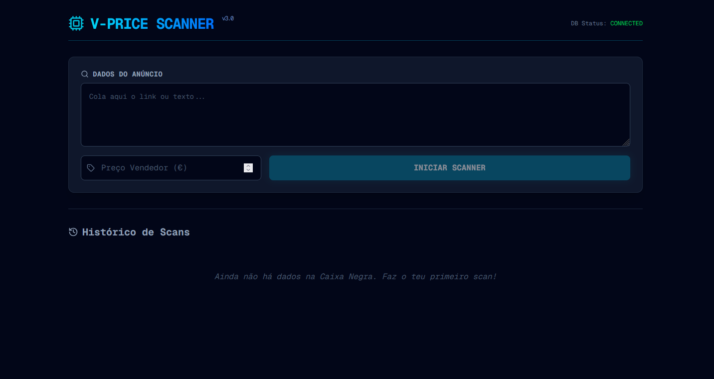

# V-Price Scanner v3.0

> **"O Mecânico Digital para Hardware Usado"**

Uma aplicação **Full-Stack Dockerizada** que avalia hardware usado em Portugal.
O sistema analisa anúncios (OLX, Facebook, ou texto livre), extrai as especificações com Inteligência Artificial, compara com preços de mercado e diz-te se o negócio compensa ou se é sucata.



## Funcionalidades Principais

- ** Cérebro Híbrido (Groq AI):** Usa o modelo **Llama-3-70b** para ler descrições confusas e extrair specs em milissegundos.
- ** Visão de Águia (Playwright):** Navega em links (OLX/Facebook) para ler o conteúdo do anúncio automaticamente.
- ** Memória de Elefante (PostgreSQL + Prisma):** Guarda todo o histórico de scans. Podes consultar, recuperar e apagar scans antigos.
- ** Detetive de Bateria:** Identifica automaticamente a saúde da bateria em iPhones e Portáteis, ajustando o valor.
- ** Mobile First:** Dashboard responsivo que funciona perfeitamente no telemóvel.
- ** Containerizado:** Roda isolado em Docker, pronto para deployment em qualquer servidor caseiro.

---

## Stack Tecnológica

### Frontend (Dashboard)
- **Next.js 14** (React)
- **Tailwind CSS** (Estilo Cyberpunk/Dark)
- **Prisma ORM** (Gestão de Base de Dados)
- **Lucide React** (Ícones)

### Backend (Motor)
- **Python FastAPI**
- **Playwright** (Web Scraping)
- **Groq SDK** (AI Inference)

### Infraestrutura
- **Docker & Docker Compose**
- **PostgreSQL 15** (Base de Dados)

---

## 🏁 Como Rodar (Modo Docker - Recomendado)

Este é o método "Chave na Mão". Não precisas de instalar Python ou Node.js no teu PC, apenas o Docker.

### 1. Pré-requisitos
- Docker e Docker Compose instalados.
- Uma chave de API da [Groq Cloud](https://console.groq.com/) (Grátis).

### 2. Configurar Variáveis de Ambiente
Cria um ficheiro `.env` na raiz do projeto com as tuas chaves:

```env
# --- Configuração da Base de Dados ---
POSTGRES_USER=...
POSTGRES_PASSWORD=tua_password_segura
POSTGRES_DB=vprice_db
POSTGRES_HOST=db
POSTGRES_PORT=5432

# URL de Conexão para o Prisma (Backend e Frontend usam isto internamente)
DATABASE_URL="postgresql://users:tua_password_segura@db:5432/vprice_db?schema=public"

# --- Inteligência Artificial ---
GROQ_API_KEY=gsk_tua_chave_aqui_xxxxxxxxxxxxx
```
---
3. Arrancar os Motores
No terminal, na raiz do projeto:

Bash
docker compose up -d --build
A primeira vez vai demorar uns minutos (a instalar dependências e browsers). Quando terminar, acede no teu browser:

👉 Dashboard: http://localhost:3012 (ou http://IP_DO_SERVIDOR:3012 se estiveres no telemóvel) 
👉 Portainer/Logs: http://localhost:9000 (se tiveres o Portainer)

Como Rodar (Modo Desenvolvimento Manual)
Se quiseres mexer no código (tunar o motor), podes rodar as peças separadamente.

1. Backend (Python)
Bash
cd backend
python -m venv .venv
source .venv/bin/activate  # ou .venv\Scripts\activate no Windows
pip install -r requirements.txt
playwright install
python main.py
O Backend ficará na porta 8000.

2. Frontend (Next.js)
Bash
cd frontend
npm install
npx prisma generate  # Atualizar o cliente da DB
npm run dev
O Frontend ficará na porta 3000.
```
Estrutura do Projeto
v-price-scanner/
├── docker-compose.yml    # O Maestro que liga tudo
├── backend/              # O Motor (Python + AI)
│    ├── main.py              # API Server
│    ├── scraper.py           # Lógica de Extração e AI
│    └── requirements.txt     # Peças do Python
├── frontend/             # O Painel (Next.js)
│   ├── app/                 # Páginas e Lógica UI
│   ├── prisma/              # Mapa da Base de Dados
│   └── Dockerfile           # Instruções de Montagem
└── README.md             # Este manual
```
Notas Importantes:

RAM: A IA tenta detetar configurações de RAM (ex: 2x8GB), mas verifica sempre as fotos do anúncio se aparecer o aviso "(Verificar Fotos)".

Desenvolvido por Vicius | 2026
